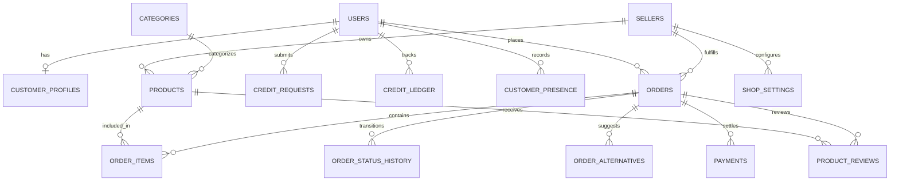

# RoomBites — Database Design & Schema Specification

- **Version:** 1.0.0
- **Status:** Approved
- **Document ID:** DOC-DB-003
- **Primary Dialect:** PostgreSQL 16+ (Fully compatible with Supabase / SQLite for local tests)
- **Timezone Convention:** UTC internally; localized to `Asia/Kolkata` (IST, UTC+5:30) for display and operating hour calculations.
- **Currency Convention:** All monetary values stored as `INTEGER` representing Indian Paise (\(₹1 = 100\text{ paise}\)).

---

## 1. Entity Relationship Diagram (Mermaid)



---

## 2. Table Definitions & Schemas

### 2.1 `users`
Core identity table for authentication and role authorization.
```sql
CREATE TABLE users (
    id VARCHAR(36) PRIMARY KEY,
    email VARCHAR(255) UNIQUE NOT NULL,
    role VARCHAR(20) NOT NULL DEFAULT 'CUSTOMER', -- 'CUSTOMER', 'ADMIN'
    is_active BOOLEAN NOT NULL DEFAULT TRUE,
    created_at TIMESTAMP WITH TIME ZONE DEFAULT CURRENT_TIMESTAMP,
    updated_at TIMESTAMP WITH TIME ZONE DEFAULT CURRENT_TIMESTAMP
);
CREATE INDEX idx_users_email ON users(email);
```

### 2.2 `customer_profiles`
Hostel delivery details and contact information.
```sql
CREATE TABLE customer_profiles (
    user_id VARCHAR(36) PRIMARY KEY REFERENCES users(id) ON DELETE CASCADE,
    full_name VARCHAR(120) NOT NULL,
    room_number VARCHAR(50) NOT NULL,
    phone_number VARCHAR(20) NOT NULL,
    credit_status VARCHAR(20) NOT NULL DEFAULT 'DISABLED', -- 'DISABLED', 'REQUESTED', 'APPROVED', 'REVOKED'
    unpaid_orders_count INTEGER NOT NULL DEFAULT 0,
    outstanding_balance_paise INTEGER NOT NULL DEFAULT 0,
    created_at TIMESTAMP WITH TIME ZONE DEFAULT CURRENT_TIMESTAMP,
    updated_at TIMESTAMP WITH TIME ZONE DEFAULT CURRENT_TIMESTAMP
);
CREATE INDEX idx_customer_room ON customer_profiles(room_number);
```

### 2.3 `sellers`
Enables seamless multi-seller expansion while defaulting to single seller in v1.
```sql
CREATE TABLE sellers (
    id VARCHAR(36) PRIMARY KEY,
    user_id VARCHAR(36) UNIQUE REFERENCES users(id),
    shop_name VARCHAR(150) NOT NULL DEFAULT 'RoomBites Night Mess',
    room_number VARCHAR(50) NOT NULL,
    emergency_contact VARCHAR(20),
    is_active BOOLEAN NOT NULL DEFAULT TRUE,
    created_at TIMESTAMP WITH TIME ZONE DEFAULT CURRENT_TIMESTAMP
);
```

### 2.4 `shop_settings`
Configurable operational hours and store availability.
```sql
CREATE TABLE shop_settings (
    id VARCHAR(36) PRIMARY KEY,
    seller_id VARCHAR(36) NOT NULL REFERENCES sellers(id),
    status VARCHAR(20) NOT NULL DEFAULT 'AVAILABLE', -- 'AVAILABLE', 'BUSY', 'CLOSED', 'SLEEPING'
    status_note VARCHAR(255),
    opening_time_ist VARCHAR(5) NOT NULL DEFAULT '21:00', -- 'HH:mm'
    closing_time_ist VARCHAR(5) NOT NULL DEFAULT '05:00', -- 'HH:mm'
    auto_schedule_enabled BOOLEAN NOT NULL DEFAULT TRUE,
    updated_at TIMESTAMP WITH TIME ZONE DEFAULT CURRENT_TIMESTAMP
);
```

### 2.5 `categories`
Product groupings.
```sql
CREATE TABLE categories (
    id VARCHAR(36) PRIMARY KEY,
    name VARCHAR(80) NOT NULL,
    slug VARCHAR(80) UNIQUE NOT NULL,
    display_order INTEGER NOT NULL DEFAULT 0,
    is_active BOOLEAN NOT NULL DEFAULT TRUE,
    created_at TIMESTAMP WITH TIME ZONE DEFAULT CURRENT_TIMESTAMP
);
```

### 2.6 `products`
Menu items with pricing in paise and customization configurations.
```sql
CREATE TABLE products (
    id VARCHAR(36) PRIMARY KEY,
    seller_id VARCHAR(36) NOT NULL REFERENCES sellers(id),
    category_id VARCHAR(36) NOT NULL REFERENCES categories(id),
    name VARCHAR(150) NOT NULL,
    description TEXT,
    price_paise INTEGER NOT NULL, -- e.g. 1500 for ₹15.00
    image_url TEXT,
    stock_status VARCHAR(20) NOT NULL DEFAULT 'IN_STOCK', -- 'IN_STOCK', 'LOW_STOCK', 'OUT_OF_STOCK'
    is_available BOOLEAN NOT NULL DEFAULT TRUE,
    has_customization BOOLEAN NOT NULL DEFAULT FALSE,
    customization_schema JSONB, -- e.g. {"sugar": ["None", "Normal", "Extra"], "strength": ["Light", "Strong"]}
    created_at TIMESTAMP WITH TIME ZONE DEFAULT CURRENT_TIMESTAMP,
    updated_at TIMESTAMP WITH TIME ZONE DEFAULT CURRENT_TIMESTAMP
);
CREATE INDEX idx_products_category ON products(category_id);
CREATE INDEX idx_products_availability ON products(is_available, stock_status);
```

### 2.7 `orders`
Master record for customer orders.
```sql
CREATE TABLE orders (
    id VARCHAR(36) PRIMARY KEY,
    order_number VARCHAR(20) UNIQUE NOT NULL, -- e.g. "RB-20261115-001"
    customer_id VARCHAR(36) NOT NULL REFERENCES users(id),
    seller_id VARCHAR(36) NOT NULL REFERENCES sellers(id),
    status VARCHAR(30) NOT NULL DEFAULT 'PLACED', 
    -- 'PLACED', 'AWAITING_APPROVAL', 'ACCEPTED', 'REJECTED', 'PAYMENT_PENDING', 'PAID', 'PREPARING', 'OUT_FOR_DELIVERY', 'DELIVERED', 'CANCELLED'
    delivery_room VARCHAR(50) NOT NULL,
    special_instructions TEXT,
    is_scheduled BOOLEAN NOT NULL DEFAULT FALSE,
    scheduled_for TIMESTAMP WITH TIME ZONE,
    subtotal_paise INTEGER NOT NULL,
    delivery_fee_paise INTEGER NOT NULL DEFAULT 0,
    discount_paise INTEGER NOT NULL DEFAULT 0,
    total_paise INTEGER NOT NULL,
    payment_method VARCHAR(20) NOT NULL, -- 'CASH', 'UPI', 'CREDIT'
    payment_status VARCHAR(20) NOT NULL DEFAULT 'PENDING', -- 'PENDING', 'VERIFIED', 'REFUNDED'
    cancellation_reason TEXT,
    estimated_delivery_time TIMESTAMP WITH TIME ZONE,
    created_at TIMESTAMP WITH TIME ZONE DEFAULT CURRENT_TIMESTAMP,
    updated_at TIMESTAMP WITH TIME ZONE DEFAULT CURRENT_TIMESTAMP
);
CREATE INDEX idx_orders_customer ON orders(customer_id);
CREATE INDEX idx_orders_status ON orders(status);
CREATE INDEX idx_orders_created_at ON orders(created_at);
```

### 2.8 `order_items`
Snapshot of ordered products with price at time of purchase.
```sql
CREATE TABLE order_items (
    id VARCHAR(36) PRIMARY KEY,
    order_id VARCHAR(36) NOT NULL REFERENCES orders(id) ON DELETE CASCADE,
    product_id VARCHAR(36) NOT NULL REFERENCES products(id),
    product_name VARCHAR(150) NOT NULL, -- Immutable snapshot
    unit_price_paise INTEGER NOT NULL,  -- Immutable snapshot
    quantity INTEGER NOT NULL,
    subtotal_paise INTEGER NOT NULL,
    selected_options JSONB,             -- e.g. {"sugar": "Normal"}
    created_at TIMESTAMP WITH TIME ZONE DEFAULT CURRENT_TIMESTAMP
);
CREATE INDEX idx_order_items_order ON order_items(order_id);
```

### 2.9 `order_alternatives`
Substitutions proposed by admin when an item runs out.
```sql
CREATE TABLE order_alternatives (
    id VARCHAR(36) PRIMARY KEY,
    order_id VARCHAR(36) NOT NULL REFERENCES orders(id) ON DELETE CASCADE,
    original_product_id VARCHAR(36) NOT NULL REFERENCES products(id),
    suggested_product_id VARCHAR(36) NOT NULL REFERENCES products(id),
    price_difference_paise INTEGER NOT NULL DEFAULT 0,
    admin_note TEXT,
    status VARCHAR(20) NOT NULL DEFAULT 'PENDING', -- 'PENDING', 'ACCEPTED', 'REJECTED'
    created_at TIMESTAMP WITH TIME ZONE DEFAULT CURRENT_TIMESTAMP,
    resolved_at TIMESTAMP WITH TIME ZONE
);
```

### 2.10 `payments`
Audit records for cash, UPI, and refunds.
```sql
CREATE TABLE payments (
    id VARCHAR(36) PRIMARY KEY,
    order_id VARCHAR(36) NOT NULL REFERENCES orders(id),
    customer_id VARCHAR(36) NOT NULL REFERENCES users(id),
    payment_method VARCHAR(20) NOT NULL, -- 'CASH', 'UPI', 'CREDIT'
    amount_paise INTEGER NOT NULL,
    status VARCHAR(20) NOT NULL DEFAULT 'PENDING', -- 'PENDING', 'VERIFIED', 'REFUNDED'
    transaction_ref VARCHAR(100), -- UPI UTR / Transaction Reference
    verified_by_user_id VARCHAR(36) REFERENCES users(id),
    verified_at TIMESTAMP WITH TIME ZONE,
    refund_reason TEXT,
    created_at TIMESTAMP WITH TIME ZONE DEFAULT CURRENT_TIMESTAMP
);
CREATE INDEX idx_payments_order ON payments(order_id);
```

### 2.11 `credit_ledger`
Double-entry financial ledger enforcing strict zero-loss accountability.
```sql
CREATE TABLE credit_ledger (
    id VARCHAR(36) PRIMARY KEY,
    customer_id VARCHAR(36) NOT NULL REFERENCES users(id),
    order_id VARCHAR(36) REFERENCES orders(id),
    entry_type VARCHAR(20) NOT NULL, -- 'DEBIT' (owed), 'CREDIT' (paid)
    amount_paise INTEGER NOT NULL,
    balance_after_paise INTEGER NOT NULL,
    description TEXT NOT NULL,
    recorded_by VARCHAR(36) NOT NULL REFERENCES users(id),
    created_at TIMESTAMP WITH TIME ZONE DEFAULT CURRENT_TIMESTAMP
);
CREATE INDEX idx_credit_ledger_customer ON credit_ledger(customer_id);
```

### 2.12 `customer_presence`
Live activity tracking visible strictly to administrators.
```sql
CREATE TABLE customer_presence (
    user_id VARCHAR(36) PRIMARY KEY REFERENCES users(id) ON DELETE CASCADE,
    is_online BOOLEAN NOT NULL DEFAULT FALSE,
    activity VARCHAR(50) DEFAULT 'idle', -- 'browsing_menu', 'viewing_item', 'cart', 'checkout'
    current_page VARCHAR(100),
    last_heartbeat TIMESTAMP WITH TIME ZONE DEFAULT CURRENT_TIMESTAMP,
    disconnected_at TIMESTAMP WITH TIME ZONE
);
```

### 2.13 `announcements` & `offers`
Seller notifications and promotions.
```sql
CREATE TABLE announcements (
    id VARCHAR(36) PRIMARY KEY,
    seller_id VARCHAR(36) NOT NULL REFERENCES sellers(id),
    title VARCHAR(150) NOT NULL,
    message TEXT NOT NULL,
    badge_type VARCHAR(20) DEFAULT 'INFO', -- 'INFO', 'ALERT', 'SPECIAL'
    is_active BOOLEAN NOT NULL DEFAULT TRUE,
    expires_at TIMESTAMP WITH TIME ZONE,
    created_at TIMESTAMP WITH TIME ZONE DEFAULT CURRENT_TIMESTAMP
);
```

---

## 3. Database Integrity & Constraints
1. **The 2-Due Credit Rule:** A database check constraint or trigger verifies that when an order is created with `payment_method = 'CREDIT'`, the customer profile's `unpaid_orders_count <= 2`.
2. **Non-negative Quantities and Prices:**
   `CHECK (price_paise >= 0)`
   `CHECK (quantity > 0)`
   `CHECK (subtotal_paise >= 0)`
3. **Foreign Key Cascade Protection:** Orders and payment records are protected from hard deletes to maintain financial audit integrity.
